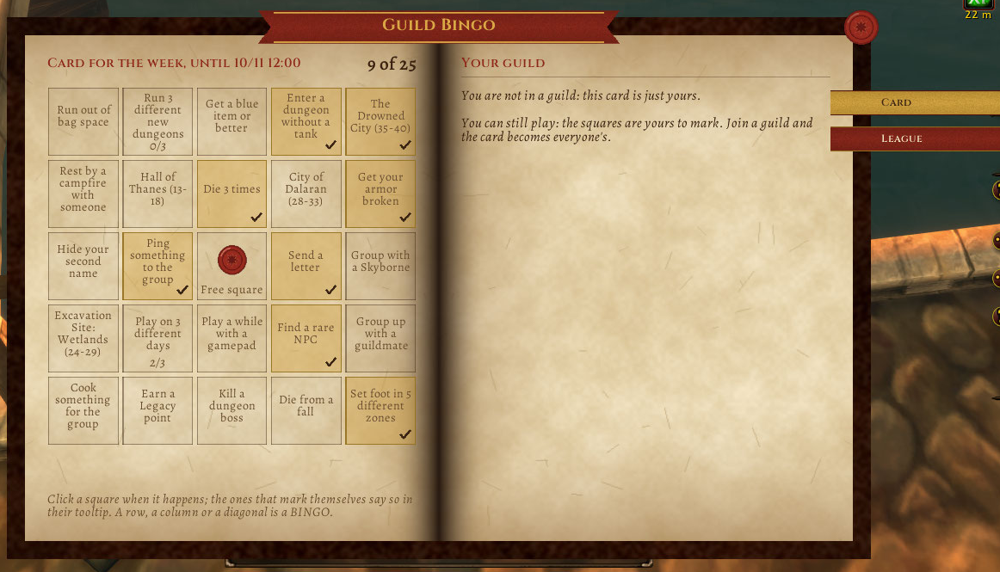

# Bingo de la Guild

A weekly bingo card to play with your guild in **WoW Forever**: 24 small, slightly silly goals ("die from a fall", "find a rare NPC", "group photo in a capital city") around a free center square. The whole guild gets the same card, everyone fills theirs while playing, and the window shows how the others are doing.

[Leer en castellano](README.md)

- Open it with `/bingo`, from the addon compartment by the minimap or with a key binding. **The window is an open book**: the card is stamped on the left page (marked squares turn gold with a tick, a complete line crimson, the free one carries a wax seal) and the cloth bookmarks on the edge turn the page: **Card** (your guild this week), **League** and, for officers only, **Officers**. It is the [Pergamino](https://github.com/JoseArgento/pergamino) skin shared with Bitácora and the rest of the family; the fonts (Alegreya and Cinzel, OFL) ship inside the addon. `/bingo sync` asks the guild for their cards again.
- **Minimap button**: left click opens the card, right click the league; drag it around the minimap, `/bingo minimapa off` hides it (`on` brings it back).
- **Language**: follows the client's, or pick one with `/bingo idioma es` / `en` / `auto` (so Spanish speakers on an English client get Spanish). The window changes at once; chat texts after a `/reload`.
- **30 goals mark themselves** (deaths, levels, a dungeon boss, quests, new zones, a duel, a letter, a flight, grouping with a guildmate, a blue item, a rare NPC, days played, the auction house, a group screenshot, and Forever's own: **each of the 9 new dungeons by name**, one or three different new dungeons, **a Legacy point**, **a Skyborne at level 10**). **30 you mark yourself**, the ones the game cannot know about, several new to Forever (set up a campsite, sit at someone else's campfire, get a blueprint, transmog something, ping the group, play with a gamepad, hide your second name...). It is a game among friends: honor system.
- **Suggest a goal**: anyone in the guild proposes one ("Suggest a goal" or `/bingo sugerir <text>`); only officers receive them, review them one by one ("Suggestions (n)" or `/bingo sugerencias`) and add or drop them. **Export / import** the goal list (officers): one goal per line, to keep it or hand it to another officer; importing replaces the goals, up to 24, cleaned like received messages.
- **Bingo** is a full row, column or diagonal. You get a center-screen alert and a button to announce it in guild chat (only when you press it).
- **League**: points over the last weeks, one per square and 5 per line.
- **Officers' card**: an officer can write up to 24 goals of their own for the week and publish them; the whole guild's card gets them, filled up from the list. Only accepted from guild ranks 0 and 1, checked in the roster.
- **A new card every weekly reset**, at the same moment for the whole realm. Hover a square to see which guildmates already have it. Without a guild the card is just yours.

**What it sends**: only on the GUILD channel, a short text like `C|3|1762300800|3fa9c1|0000011111001000000000000` (version, week, which card, one digit per square); marks are only compared between players with the same card. What arrives is parsed with patterns and stored as text, never run. Messages from other channels, malformed, from another week, too long or from yourself are dropped; at most 5 messages per 10 seconds per sender; at most 1000 cards (a guild's maximum); suggestions (`S|3|<week>|<text>`) are kept by officers only, up to 50, no repeats from one person. It never writes in chat by itself. Trial accounts cannot send addon messages in Forever: the addon notices, does not try, and tells you.

**Tested**: every API it uses was checked against Forever 1.60.1's dumps and UI source (`tools/check_api.py`); forever-lint only shows notes the addon already handles (FL012 trial accounts, FL013 double PLAYER_DEAD and stale zone text); Addon Sentry finds no risk signals; 101 tests run two or more clients side by side in Lua 5.1 and pass messages between them. **In the client** (since launch): the book, the card, squares that mark themselves by level and zone, the league and the minimap button, with a single player. **Not seen yet**: a whole guild running it at once (other players' cards, the officers' card and suggestions were tested with several simulated clients), that `C_DateAndTime.GetSecondsUntilWeeklyReset` gives Forever's reset (otherwise it falls back to Monday-to-Monday UTC weeks), that the goal events fire as in other clients, that the announce button can post in guild chat, that `GetInstanceInfo()` gives the new dungeons' English names (on other locales those squares are clicked by hand), and that `UnitRace("player")` says "Skyborne".

**If something breaks:** `/bingo errores` shows the addon's last error (the last 10 are kept, no popups) to copy into a GitHub issue. The "Errors" bookmark only shows while there is something kept.

## Support

All of this is free and open source, and it stays that way: no paid features, nothing early for supporters. If it helped you and you want to cover the time it takes to keep it working (every Blizzard patch means refreshing the data and fixing what broke), you can do that on [Patreon](https://www.patreon.com/cw/DoblePupi). Thanks ♥

Not affiliated with Blizzard Entertainment. MIT license.
